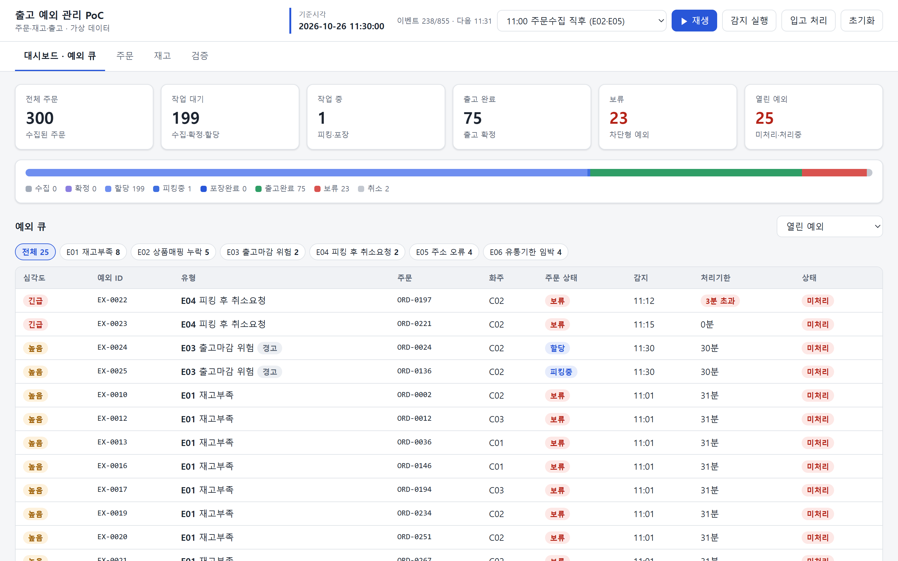
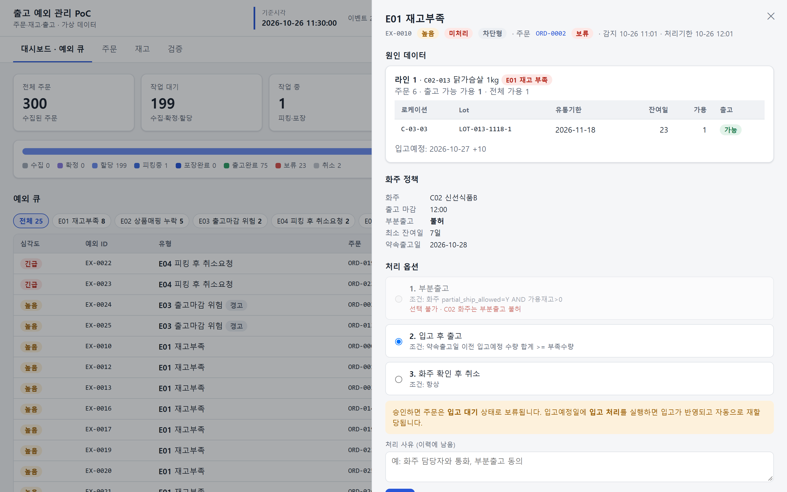
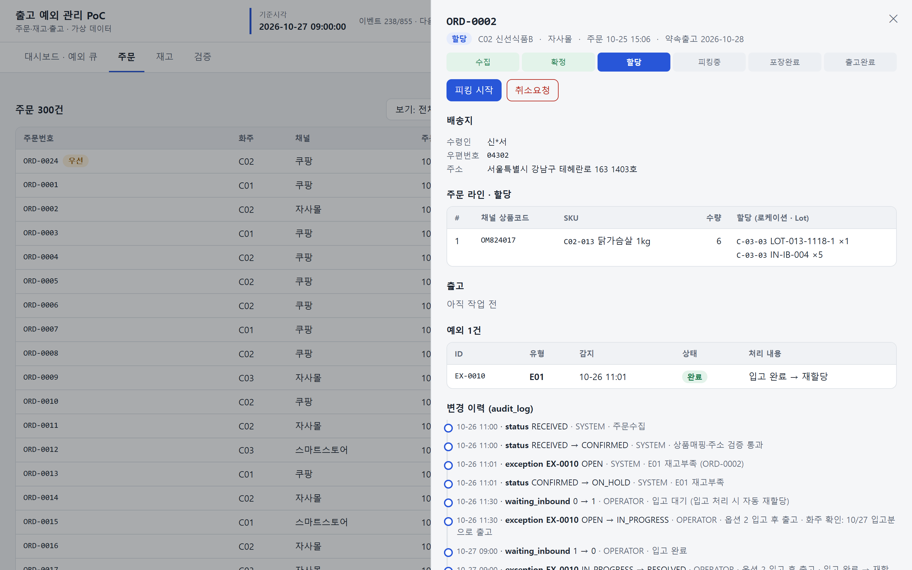
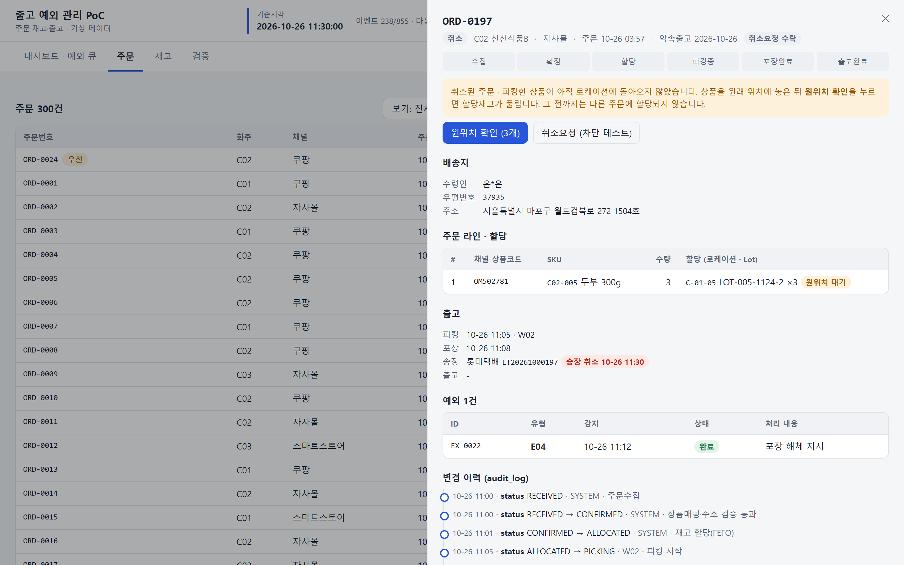
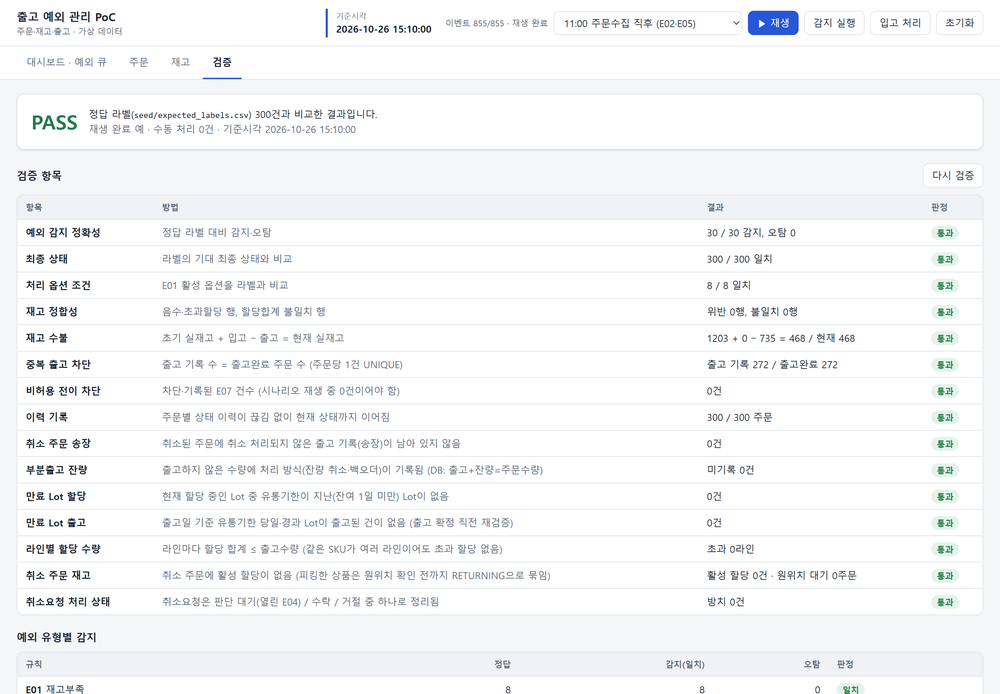
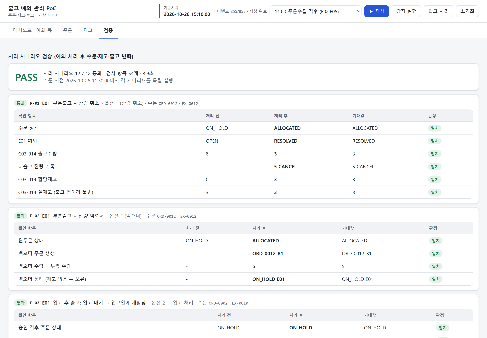

# 주문·재고·출고 예외 관리 시스템 PoC

풀필먼트 센터의 출고 예외(재고부족, 매핑누락, 마감위험, 피킹 후 취소, 주소오류, 유통기한 임박)를 **규칙으로 감지**하고, 운영자가 **정책에 따른 처리 옵션을 승인**하면 상태·재고·이력이 반영되는 PoC입니다.
다중 화주 풀필먼트 센터를 가정해 가상 데이터로 설계, 구현, 검증한 개인 프로젝트이며, AI 개발 도구를 활용해 구현했습니다.

> **▶ 데모 바로가기:** [https://chihokim500.github.io/logistics-exception-poc/](https://chihokim500.github.io/logistics-exception-poc/)
>
> 설치 없이 브라우저에서 실행됩니다 (첫 실행 약 10초 로딩, 새로고침하면 초기화). 구성과 배포 방법: [static_demo/README.md](static_demo/README.md)

## 한눈에 보기

| 구분 | 내용 |
|---|---|
| 업무 범위 | 주문 수집 → 상품매핑·배송지 검증 → FEFO 재고 할당 → 피킹 → 포장 → 출고 확정 |
| 예외 정책 | 예외 7종(E01~E07) 감지 조건, 처리 옵션, 화주별 정책(부분출고 허용, 출고 마감, 최소 잔여일) |
| 검증 | 주문 300건 재생: 정답 예외 30건 감지, 오탐 0 · 검증 15항목 통과 · 처리 시나리오 12종(54개 항목) 통과 · 자동 테스트 50개 통과 |
| 기술 | Python 표준 라이브러리, SQLite, Vanilla JS · 정적 데모는 Pyodide로 같은 엔진을 브라우저에서 실행 |
| 데이터 | 화주 3곳, SKU 50개, 주문 300건(438라인), 당일 이벤트 855건 — 모두 가상 데이터 |

## 주요 화면

| 대시보드·예외 큐 | 예외 처리 옵션 (E01 재고부족) |
|---|---|
|  |  |
| 상태별 주문 현황과 심각도·처리기한 순 예외 큐 | 화주 정책과 입고예정에 따라 처리 옵션이 활성·비활성 |

| 입고 대기 → 재할당 이력 | 피킹 후 출고 중단 (원위치 대기) |
|---|---|
|  |  |
| 입고예정일에 입고 처리 후 자동 재할당, 변경 이력 기록 | 송장 취소, 원위치 확인 전까지 재고를 다른 주문에 할당하지 않음 |

| 검증 (정답 라벨 비교) | 처리 시나리오 검증 |
|---|---|
|  |  |
| 정답 300건 비교와 재고·이력 정합성 15항목 | 예외 처리 12종을 처리 전, 처리 후, 기대값으로 비교 |

설계 근거(상태 전이, ERD, 예외 정책, 설계 결정 기록, 테스트 시나리오)는 [물류PoC_설계초안.md](물류PoC_설계초안.md)에 정리했습니다.

## 실행

Python 3.10 이상만 있으면 됩니다. 외부 라이브러리는 쓰지 않습니다.

```bash
python app/server.py
```

브라우저에서 http://localhost:8000 을 엽니다. 포트를 바꾸려면 `--port 8765`를 붙입니다. DB는 `data/logistics.db`에 생기며, 화면의 **초기화** 버튼으로 시드 상태로 되돌릴 수 있습니다.

```bash
python -m unittest discover -s tests -v
```

테스트 50개(설계초안 9장 TS-01~15, 보조 시나리오, 코드 검토 1·2차·재검토 회귀, 처리 시나리오 12종)가 실행됩니다.

### 서버 없이 보기 (정적 데모)

`static_demo/` 폴더는 같은 엔진을 브라우저 안에서 실행하는 정적 데모입니다. GitHub Pages에 올리면 링크만으로 모든 기능을 쓸 수 있습니다. 구성과 배포 방법은 [static_demo/README.md](static_demo/README.md)를 참고하세요.

## 시연 순서 (약 7분)

1. **초기화** → 재생 시점 `11:00 주문수집 직후` → **▶ 재생**
   주문 300건이 들어오고, 상품매핑 누락(E02) 5건과 주소 오류(E05) 4건이 바로 보류됩니다.
2. `11:01 재고할당 직후` → 재생
   주문시각 순서로 FEFO 할당이 진행되고, 재고부족(E01) 8건과 유통기한 임박(E06) 4건이 생깁니다.
3. 예외 큐에서 **E01**을 엽니다. 화주가 C01이면 부분출고가 가능하고, C02이면 "부분출고 불허"라는 사유와 함께 비활성화됩니다. 입고예정이 약속출고일 전에 있으면 "입고 후 출고"가 활성화됩니다.
   - 약속출고일이 10-28인 C02 주문에서 **입고 후 출고**를 승인하면 주문은 **입고 대기**로 보류됩니다. 아직 들어오지 않은 재고로는 할당하지 않습니다. 이때 **입고 처리**를 눌러도 입고예정일(10-27) 전이라 할당되지 않습니다.
   - 재생 시점 `10-27 09:00 다음날` → 재생 → **입고 처리**를 누르면 입고 Lot이 생기고 자동으로 재할당됩니다.
   - C01·C03 주문에서 **부분출고**를 고르면 잔량을 "잔량 취소" 또는 "백오더(원주문-B1 생성)" 중에서 선택할 수 있습니다.
4. `11:30 C02 마감 30분 전` → 재생
   피킹 후 취소요청(E04)과 마감위험 경고(E03)가 생깁니다. E03은 경고형이라 작업을 멈추지 않습니다.
5. 포장 후 취소요청(E04)을 **출고 중단**으로 처리합니다. 주문과 송장은 바로 취소되지만, 재고는 "원위치 대기"로 묶여 다른 주문에 할당되지 않습니다. 주문 상세에서 **원위치 확인**을 눌러야 재고가 풀립니다. E03은 **우선 작업 지정**으로 처리하면 주문 탭 "보기: 피킹 대기열"의 맨 앞으로 옵니다.
6. 주문 탭에서 출고완료 주문을 열고 **취소요청 (차단 테스트)**를 누릅니다. 409로 차단되고 E07로 기록됩니다.
7. **초기화 → 끝까지 재생 → 검증 탭**을 엽니다. 정답 라벨 300건과 비교한 결과가 **PASS**로 나오고, 검증 항목 15개가 모두 통과합니다.
8. 검증 탭 아래의 **처리 시나리오 실행**을 누릅니다(약 5초). 예외 처리 12종을 임시 DB에서 각각 실행해 처리 전후 값을 기대값과 비교하고, **12 / 12 통과**가 나옵니다.

> 검증 탭 위쪽의 정답 라벨은 "시나리오를 끝까지 재생하고 수동 처리를 하지 않은 상태"가 기준입니다. 3·5·6번처럼 직접 처리한 뒤에는 FAIL과 안내 문구가 나오는 것이 정상입니다. 처리 결과가 맞는지는 8번의 처리 시나리오 검증으로 확인합니다. 이 검증은 현재 DB와 상관없이 언제든 실행할 수 있습니다.

## 구조

| 경로 | 내용 |
|---|---|
| `물류PoC_설계초안.md` | 문제 정의, 상태 전이, ERD, 예외 정책, 테스트 시나리오, 검증 결과 |
| `seed/` | 가상 시드 데이터, 이벤트 시나리오, 정답 라벨 (`seed/README.md`) |
| `scripts/gen_seed.py` · `verify_seed.py` | 시드 생성기, 독립 검증기 (엔진과 별개로 규칙을 구현해 교차 확인) |
| `app/engine.py` | 도메인 엔진: SQLite 스키마, 상태 전이, FEFO 할당, 예외 감지·처리, 이벤트 재생, 검증 |
| `app/scenarios.py` | 처리 시나리오 검증 12종 (임시 DB에서 처리 전후 비교) |
| `app/server.py` | 표준 라이브러리 HTTP 서버와 JSON API |
| `scripts/capture.py` | 포트폴리오용 시연 화면 캡처 (Edge 헤드리스) |
| `app/static/` | 화면: 대시보드·예외 큐 / 주문 / 재고 / 검증 |
| `tests/test_scenarios.py` | TS-01~15와 보조 시나리오 |

## API

| Method | Path | 설명 |
|---|---|---|
| GET | `/api/summary` | 상태별 건수, 열린 예외, 기준시각, 재생 진행 |
| GET | `/api/orders?status=&client=&q=` | 주문 목록 |
| GET | `/api/orders/{id}` | 주문 상세 (라인·할당·출고·예외·이력·가능한 동작) |
| POST | `/api/orders/import` | 주문수집 CSV 업로드 (본문이 CSV). 정합성이 깨진 주문은 `rejected`에 사유와 함께 돌려주고 나머지는 등록 |
| POST | `/api/orders/{id}/allocate` | 재고 할당 |
| POST | `/api/orders/{id}/transition` | `{"to": "PICKING"\|"PACKED"\|"SHIPPED"}`. 허용되지 않으면 409 + E07 |
| POST | `/api/orders/{id}/cancel-request` | 취소요청 (단계에 따라 즉시 취소 / E04 / 409) |
| GET | `/api/inventory?client=&q=` | SKU별 재고와 Lot |
| GET | `/api/exceptions?status=open\|all&rule=` | 예외 큐 |
| GET | `/api/exceptions/{id}` | 원인 데이터, 처리 옵션(활성 여부·사유) |
| POST | `/api/exceptions/{id}/resolve` | `{"option", "reason", "params"}`. 옵션 조건은 서버에서 다시 검사 |
| POST | `/api/sim/reset` · `/api/sim/replay` · `/api/sim/clock` · `/api/sim/run-detection` | 데모 제어 |
| POST | `/api/orders/{id}/confirm-restock` | 피킹 후 취소된 주문의 상품 원위치 확인 → 할당재고 해제 |
| GET | `/api/work-queue` | 피킹 대기열 (우선 작업 → 오늘 마감 빠른 순 → 약속출고일 → 주문시각) |
| POST | `/api/sim/receive-inbound` | 입고예정일 ≤ 기준일인 입고 반영, 입고 대기 주문 재할당 |
| GET | `/api/verify` | 정답 라벨 비교와 정합성 검사 |
| GET | `/api/verify/scenarios` | 처리 시나리오 12종 실행 (현재 DB에 영향 없음) |

나중에 LLM이나 Dify를 붙일 때는 GET API만 열어 줍니다. 상태를 바꾸는 POST는 운영자 승인 화면에서만 호출합니다.

## 범위와 한계

- 실제 쇼핑몰·택배사 API 연동, 입고·반품·재고실사 프로세스, 로그인·권한은 범위 밖입니다. 작업자와 운영자 구분은 actor 값으로만 기록합니다.
- 화주 정책값(마감시각, 마감 30분 전 경고, 최소 잔여일 7일, 처리기한)은 PoC를 위해 임의로 정한 값입니다.
- 실제 기업 데이터를 쓰지 않았으므로 효율 개선 수치는 제시하지 않습니다. 검증은 정답 라벨과 정합성 검사로만 합니다.

## 감지 방식

E03 마감위험 감지는 운영에서 스케줄러가 10분마다 실행한다고 가정합니다. PoC에는 상시 스케줄러가 없으므로 시나리오 재생 중의 감지 이벤트(`events.csv`의 `RUN_DETECTION`, 11:10~15:00 10분 간격) 또는 상단 **감지 실행** 버튼으로만 실행됩니다. 기준시각만 바꿔서는 감지되지 않습니다.
