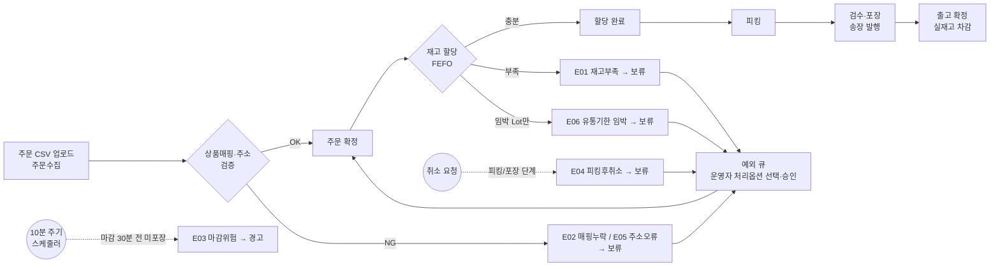
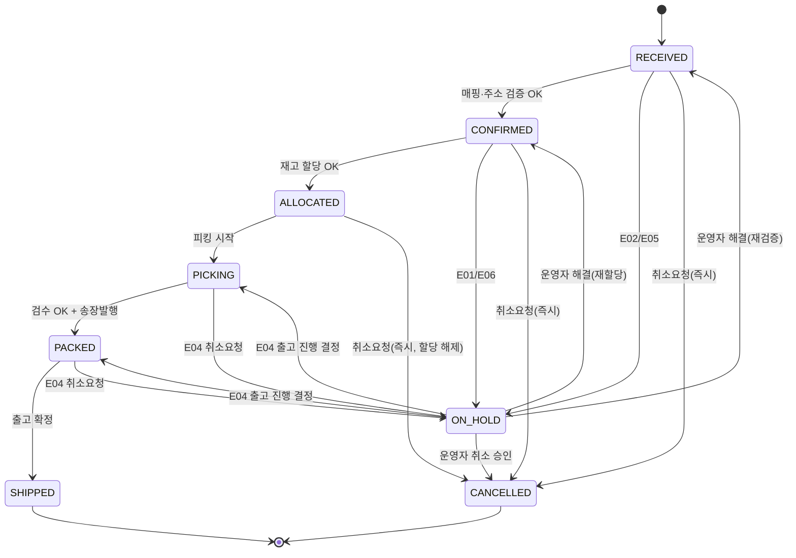
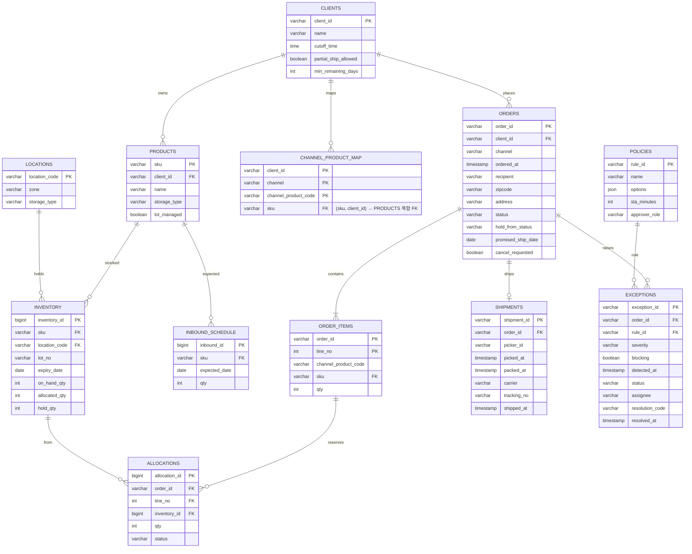

# 주문·재고·출고 예외 관리 시스템 PoC — 설계 초안 v0.1

> 작성일 2026-10-23 · 개인 PoC · 모든 데이터는 가상 데이터이며 실제 기업 운영 데이터를 사용하지 않았습니다.

---

## 1. 문제 정의

### 1.1 배경
풀필먼트 센터에 들어온 주문이 모두 바로 출고되지는 않습니다. 재고 부족, 상품코드 매핑 누락, 주소 오류, 피킹 이후 취소 요청 같은 **출고 예외**가 생기면 운영자가 이를 찾아내 판단하고 처리해야 합니다.

### 1.2 AS-IS / TO-BE

| 구분 | AS-IS (가정) | TO-BE |
|---|---|---|
| 예외 발견 | 운영자가 주문 목록과 엑셀을 대조해 직접 찾음 | 시스템이 **정의된 규칙**으로 예외를 감지해 예외 큐에 등록 |
| 판단 기준 | 담당자 경험에 의존 | 예외 유형별 **정책 매트릭스** (처리 옵션, 담당, 처리기한) |
| 처리 | 메신저·전화로 확인한 뒤 수기로 상태 변경 | 처리 옵션 선택 → 승인 → 상태·재고 자동 반영 |
| 이력 | 남지 않거나 흩어짐 | 변경 전후 값, 처리자, 사유를 `audit_log`에 기록 |

> AS-IS는 공개자료를 바탕으로 한 **가정**입니다. 현장에서 검증된 내용이 아닙니다.

### 1.3 사용자

| 사용자 | 목표 | PoC 반영 |
|---|---|---|
| 센터 운영자 | 예외 주문을 마감 전에 처리 | 예외 큐, 처리 옵션 선택과 승인 |
| 현장 작업자 | 피킹·포장·출고 처리 | 상태 변경 버튼 (시뮬레이션) |
| 화주사 (셀러) | 자기 주문의 출고 여부 확인 | 화주별 정책값 (마감시간, 부분출고 허용 여부), 화면은 범위 외 |

### 1.4 설계 원칙
1. **결과가 정확해야 하는 기능은 규칙과 DB 제약으로 구현합니다.** 재고 할당, 상태 변경, 예외 감지가 여기에 해당합니다.
2. **시스템은 감지하고 제안할 뿐, 확정은 사람이 합니다.** 상태가 바뀌는 처리는 운영자 승인을 거칩니다.
3. **검증할 수 없는 성과 수치는 쓰지 않습니다.** 대신 정답 라벨과 비교한 결과를 제시합니다.

### 1.5 범위

| 포함 | 제외 (한계로 명시) |
|---|---|
| 주문수집(CSV 업로드), 확정, 할당, 피킹, 포장, 출고 | 실제 쇼핑몰·택배사 API 연동 |
| 예외 7종 감지와 처리 | 입고·반품·재고실사 프로세스 |
| 화주 3곳의 화주별 정책 | 로그인과 권한 (역할만 선택하는 방식으로 대체) |
| 데모용 기준시각 설정 | 피킹 동선 최적화, WCS·설비 연동 |

---

## 2. 출고 프로세스 플로우

---

## 3. 주문 상태 설계

### 3.1 상태 정의

| 코드 | 상태 | 설명 |
|---|---|---|
| RECEIVED | 수집 | CSV로 들어왔고 아직 검증 전 |
| CONFIRMED | 확정 | 상품매핑과 주소 검증 통과 |
| ALLOCATED | 할당 | 모든 라인에 재고(Lot·로케이션) 예약 완료 |
| PICKING | 피킹중 | 작업자가 피킹 시작 |
| PACKED | 포장완료 | 검수·포장 완료, 송장번호 발행 |
| SHIPPED | 출고완료 | 출고 확정, 실재고 차감 (최종 상태) |
| ON_HOLD | 보류 | 차단형 예외 발생. 보류 직전 상태를 `hold_from_status`에 저장 |
| CANCELLED | 취소 | 최종 상태 |

### 3.2 상태 전이도

### 3.3 전이 규칙표

| # | From → To | 실행 주체 | 사전조건 | 재고 영향 |
|---|---|---|---|---|
| T1 | RECEIVED → CONFIRMED | 시스템 | 모든 라인 SKU 매핑 OK, 우편번호 5자리, 주소 있음 | 없음 |
| T2 | CONFIRMED → ALLOCATED | 시스템 | 모든 라인 가용재고 ≥ 주문수량 (FEFO로 Lot 선택) | `allocated_qty` 증가 |
| T3 | ALLOCATED → PICKING | 작업자 | 없음 | 없음 |
| T4 | PICKING → PACKED | 작업자 | 피킹수량 = 할당수량, 송장번호 발행 | 없음 |
| T5 | PACKED → SHIPPED | 작업자 | 송장번호 있음, `shipped_at`이 비어 있음 | `on_hand_qty`, `allocated_qty` 감소 |
| T6 | 출고 전 상태 → ON_HOLD | 시스템 | 차단형 예외 생성 | 없음 (할당은 유지) |
| T7 | ON_HOLD → 복귀 상태 | 운영자 | 연결된 예외가 모두 RESOLVED | 처리 옵션에 따라 다름 |
| T8 | RECEIVED·CONFIRMED·ALLOCATED → CANCELLED | 시스템 | 취소 요청 | 할당이 있으면 해제 |
| T9 | ON_HOLD(E04) → CANCELLED | 운영자 | 출고 중단 승인 | 송장 취소. 피킹한 상품은 할당을 RETURNING(원위치 대기)으로 묶어 두고, **원위치 확인** 후 할당 해제 (v0.4) |
| T10 | ON_HOLD(E01 입고 대기) → CONFIRMED → ALLOCATED | 시스템 (입고 처리) | 입고예정일 ≤ 기준일인 입고가 반영되어 부족분이 채워짐 | 입고 Lot 생성(`on_hand_qty` 증가) 후 할당 |

**차단 규칙 (위반 시 E07로 기록):**
- SHIPPED → CANCELLED: 차단합니다. 반품 프로세스로 넘어가야 하며 PoC 범위 밖입니다.
- PICKING·PACKED → CANCELLED 직접 전이: 차단합니다. 반드시 E04 보류를 거칩니다.
- 이미 SHIPPED인 주문에 출고 확정 재실행: 중복 출고로 차단합니다.
- 위 표에 없는 모든 전이: 차단합니다.

### 3.4 설계 결정 기록

| 결정 | 선택 | 이유 |
|---|---|---|
| 실재고 차감 시점 | **출고 확정(T5)** | 피킹 시점에 차감하면 피킹 후 취소 때 원복 처리가 복잡해집니다. 할당재고로 이중 판매를 막으면 충분합니다. |
| 가용재고 계산 | `on_hand − allocated − hold` | 보류재고(불량, 검수 대기)는 판매할 수 없는 재고로 분리합니다. |
| Lot 선택 | FEFO (유통기한 빠른 순), 같으면 입고일 빠른 순 | 식자재·식품 화주 대응 (딜리버리랩 연계) |
| 부분 할당 | 하지 않습니다. 전량을 할당하거나 E01을 냅니다 | 부분출고 여부는 운영자가 판단할 정책 사항입니다. 시스템이 자동으로 결정하지 않습니다. |
| 입고 후 출고 | 승인하면 **입고 대기**로 보류하고, 입고예정일에 입고 처리될 때 재할당 | 아직 들어오지 않은 재고로 할당하면 실물 없이 피킹 지시가 나갑니다. (v0.1은 승인 즉시 입고 처리하던 것을 v0.2에서 수정) |
| 부분출고 잔량 | 잔량 취소 또는 백오더(원주문-B1) 중 운영자가 선택해 라인에 기록. DB 제약 `출고수량 + 잔량 = 주문수량` | 미출고분 기록이 없으면 정산·CS에서 근거가 사라집니다. |
| 출고 중단 시 송장 | 발행된 송장을 취소 처리(`shipments.cancelled_at`) | 취소된 주문에 유효 송장이 남으면 택배 집하와 데이터가 어긋납니다. |
| 같은 SKU가 여러 라인 | 라인 순서대로 재고를 예약하는 **하나의 할당 계획**을 할당·부분출고 판단·화면이 함께 사용 (v0.3) | 라인마다 같은 재고를 따로 보면 4+4개 주문에 가용 5개일 때 부족을 감지하고도 부분출고 수량을 계산하지 못합니다. |
| 상품코드 매핑 키 | `(client_id, channel, channel_product_code)` (v0.3) | 여러 화주가 같은 채널에서 같은 상품코드를 쓸 수 있습니다. 키에 화주가 없으면 한 화주의 매핑 등록이 다른 화주의 매핑을 덮어씁니다. 화주가 채널 계정을 여러 개 쓰면 `channel_account_id`도 키에 넣어야 합니다. |
| 유통기한 경과 Lot | 잔여일 1일 미만(당일·경과) Lot은 **만료**로 가용재고에서 제외. E06 승인은 화주 최소 잔여일 기준만 완화 (v0.3) | '기준 완화'와 '만료품 출고 허용'은 다른 결정입니다. 만료품은 어떤 승인으로도 출고하지 않습니다. |
| E01·E06 복합 예외 | 라인마다 부족 유형을 구분(`E06`=임박 Lot 결정 대기, `E01`=실제 부족 또는 임박 거절)하고, E06 결정은 라인(`order_items.near_expiry_ok`)에 저장. E01 처리는 E01 라인만 바꿈 (v0.5) | 한 주문에서 A는 재고부족, B는 임박일 때 E06에서 승인한 B가 E01 부분출고 과정에서 잔량 취소되던 문제를 막습니다. 어떤 예외를 먼저 처리해도 결과가 같습니다. |
| 출고 시점 유통기한 재검증 | 출고 확정 직전에 할당 Lot을 다시 검사: 만료면 항상 차단, 화주 최소 잔여일 미달이면 E06 승인 라인만 허용. 차단은 409 + E07 기록 (v0.5) | 할당 뒤 시간이 지나 만료되는 Lot이 있습니다. 할당 시점 검사만으로는 출고 시점 품질을 보장하지 못합니다. (Lot 교체 재피킹 프로세스는 범위 밖) |
| 부분출고 가능 조건 | 주문 전체에서 지금 출고할 수 있는 수량이 1개 이상이면 허용. 재고 0인 상품은 출고수량 0 + 잔량(취소/백오더) (v0.5) | '부분출고 허용'은 보낼 수 있는 것부터 먼저 보낸다는 뜻이므로, 한 상품의 재고가 0이어도 다른 상품이 있으면 허용해야 합니다. |
| 매핑-상품 화주 일치 | DB 복합 FK `(sku, client_id) → products`, 시드 적재 시 검사 후 거부, 주문 검증에서도 소유 화주 재확인(E02) (v0.5) | 화면 등록만 검사하면 CSV·직접 입력으로 들어온 잘못된 매핑이 다른 화주 상품을 출고시킵니다. 세 단계에서 같은 규칙을 지킵니다. |
| 피킹 후 취소의 재고 해제 | 출고 중단 시 주문·송장은 바로 취소, 재고는 **원위치 확인 후** 해제 (v0.4) | 상품이 작업자 손이나 포장대에 있는 동안 재고를 풀면, 다른 주문이 실물 없는 재고를 할당받습니다. |
| 취소요청 결과 | `cancel_result`: PENDING(판단 대기) → ACCEPTED(취소) / REJECTED(출고 진행). 결정되면 요청 플래그를 내림 (v0.4) | 출고 진행을 결정한 뒤에도 "취소요청" 표시가 남으면 CS와 현장이 다른 판단을 합니다. |
| 우선 작업 | `priority`를 재고 할당 순서와 **피킹 대기열**(우선 → 오늘 마감 빠른 순 → 약속출고일 → 주문시각)에 반영 (v0.4) | 표시만 바뀌고 작업 순서가 그대로면 마감 위험 대응이 실제로 이뤄지지 않습니다. |
| 주문수집 파일 검증 | 같은 주문번호 행들의 화주·채널·주문시각·수령인·배송지·약속출고일이 모두 같아야 하고, 라인번호 중복·수량·날짜 형식을 검사. 깨진 주문만 사유와 함께 거부, 나머지는 등록 (v0.4) | 파일 하나의 오류로 전체를 막으면 정상 주문까지 늦어지고, 그냥 받으면 첫 행 기준으로 잘못된 주문이 만들어집니다. 우편번호·주소 오류는 거부하지 않고 E05로 처리합니다(업무 예외). |
| 마감위험 감지 방식 | 상시 스케줄러 없음. 시나리오 이벤트(RUN_DETECTION, 10분 간격) 또는 감지 실행 버튼으로 1회 실행 (v0.4 명시) | 운영에서는 스케줄러가 10분마다 호출한다고 가정합니다. 기준시각만 바꿔서는 감지되지 않습니다. |
| E03 처리 방식 | 보류하지 않고 **경고만** 합니다 | 작업은 계속 진행해야 하므로 우선순위만 올립니다. |

---

## 4. 데이터 모델 (ERD)

**`audit_log` (모든 상태·재고 변경 기록):** log_id, entity(order/inventory/exception), entity_id, field, before_value, after_value, actor, reason, created_at

**DB 제약 (정합성 보장):**
- `CHECK (allocated_qty + hold_qty <= on_hand_qty)`
- `CHECK (on_hand_qty >= 0)`
- 할당과 출고 처리는 **하나의 트랜잭션**으로 묶습니다. 재고 부족 판정과 할당 증가 사이에 다른 주문이 끼어들지 못하게 합니다.
- `shipments.order_id UNIQUE`: 주문당 출고는 1건만 허용합니다 (중복 출고 방지).

> 구현은 SQLite로 하고, 문서 표기는 PostgreSQL 타입으로 합니다 (샌드부스터 공고의 PostgreSQL 요건 반영).

---

## 5. 예외 정책 매트릭스

| 코드 | 예외 | 감지 시점 | 감지 조건 | 유형 | 심각도 | 처리 옵션 | 담당 | 처리기한 |
|---|---|---|---|---|---|---|---|---|
| E01 | 재고부족 | 할당(T2) | 라인별 `주문수량 > Σ가용재고` | 차단 | 높음 | ① 부분출고 (화주가 허용한 경우만, 잔량 취소/백오더 선택) ② 입고 후 출고 (입고예정일 ≤ 약속출고일인 경우만, 입고 대기 → 입고 처리 시 재할당) ③ 화주 확인 후 취소 | 운영자 | 60분 |
| E02 | 상품매핑 누락 | 확정(T1) | `channel_product_code`에 대응하는 매핑 없음 | 차단 | 중간 | ① SKU 매핑 등록 후 재검증 ② 화주 문의 | 운영자 | 120분 |
| E03 | 출고마감 위험 | 감지 실행 시 (운영 가정: 10분 주기 스케줄러) | 오늘 출고 약속 & `기준시각 ≥ cutoff − 30분` & 상태가 CONFIRMED·ALLOCATED·PICKING | 경고 | 높음 | ① 우선 작업 지정 ② 익일 출고로 전환 (화주 알림) | 운영자 | 마감시각까지 |
| E04 | 피킹 후 취소요청 | 취소 요청 시 | `cancel_requested = true` & 상태가 PICKING·PACKED | 차단 | 긴급 | ① 출고 중단 (송장 취소, 원위치 확인 후 재고 해제) ② 출고 진행 (고객 반품 안내) | 운영자 | 15분 |
| E05 | 주소 오류 | 확정(T1) | 우편번호가 5자리 숫자가 아니거나 주소가 비어 있음 | 차단 | 중간 | ① 주소 수정 후 재검증 ② 화주 문의 | 운영자 | 120분 |
| E06 | 유통기한 임박 | 할당(T2) | 만료되지 않은 가용 Lot의 남은 일수가 모두 `min_remaining_days` 미만 (만료 Lot은 처음부터 제외 → 남은 게 만료뿐이면 E01). 결정은 라인에 저장, 출고 확정 직전 재검증 | 차단 | 중간 | ① 임박 Lot 출고 (화주 승인) ② 재고부족으로 처리 (E01 옵션 적용) | 운영자 | 60분 |
| E07 | 비허용 전이·중복 출고 | API 호출 시 | 3.3의 차단 규칙 위반 | 기록 | 낮음 | 처리 불필요 (시스템이 차단하고 로그만 남김) | 없음 | 없음 |

**예외 상태:** OPEN → IN_PROGRESS (담당자 지정) → RESOLVED (처리 옵션 실행 완료)

**옵션 노출 규칙:** 조건을 충족하지 않는 옵션은 화면에서 비활성화하고, 비활성 사유를 함께 표시합니다. 예: "C02 화주는 부분출고 불허".

---

## 6. 시드 데이터 생성 규칙

### 6.1 화주

| client_id | 이름 (가상) | 업종 | cutoff | 부분출고 | 최소 잔여일 |
|---|---|---|---|---|---|
| C01 | 생활잡화A | 상온 | 14:00 | Y | 없음 |
| C02 | 신선식품B | 냉장 | 12:00 | N | 7 |
| C03 | 패션C | 상온 | 15:00 | Y | 없음 |

### 6.2 규모와 생성 규칙

| 데이터 | 규모 | 규칙 |
|---|---|---|
| products | 50 (C01 20, C02 15, C03 15) | C02 상품은 `lot_managed = Y` |
| locations | 60 | 상온 A·B존 40개, 냉장 C존 20개, 코드 형식 `존-열-단` (A-01-02) |
| inventory | 69 | C02 상품은 SKU당 Lot 2~3개 (같은 로케이션), 유통기한 분산, 보류재고 6건 |
| channel_product_map | 95 | 화주별 2개 채널 × 상품 (100건) 중 5건 의도적 누락 (E02용) |
| inbound_schedule | 15 | 5건은 E01 처리옵션 ② 판정용 |
| orders_import | 300 주문 / 438 라인 | 주문수집 원본 형식 (SKU 없이 채널 상품코드만). 채널: 스마트스토어 / 쿠팡 / 자사몰 |
| events | 855 | 데모 당일 이벤트 재생 시나리오 (피킹·포장·출고·취소요청·10분 주기 감지) |
| expected_labels | 300 | 정답 라벨: 예외 30건 + NONE 270건 (오탐 검증용) |

### 6.3 예외 정답 라벨 배분 (총 30건)

| E01 | E02 | E03 | E04 | E05 | E06 |
|---|---|---|---|---|---|
| 8 (부분출고 허용 화주 4, 불허 화주 4) | 5 | 5 | 4 | 4 | 4 |

E07은 시드 데이터가 아니라 테스트 시나리오로 검증합니다. 나머지 270건은 예외 없이 정상 처리되어야 합니다 (오탐 0 검증).

**파일 형식:** `seed/*.csv` (UTF-8 BOM, 엑셀 호환), `seed/policies.json`, `seed/expected_labels.csv`

**생성·검증:** `scripts/gen_seed.py`로 생성하고 `scripts/verify_seed.py`로 검증합니다. 검증기는 3·5장 규칙대로 이벤트를 재생해 정답과 비교하며, 구현 시스템의 기준 동작 역할을 합니다. 자세한 내용은 `seed/README.md`를 참고하세요.

---

## 7. API

| Method | Path | 설명 |
|---|---|---|
| POST | `/api/orders/import` | 주문 CSV 업로드 → RECEIVED, 이어서 T1 검증 실행 |
| GET | `/api/orders?status=&client=` | 주문 목록 |
| GET | `/api/orders/{id}` | 상세 (라인, 할당, 출고, 예외, 이력) |
| POST | `/api/orders/{id}/allocate` | T2 실행 |
| POST | `/api/orders/{id}/transition` | `{to, actor}` T3~T5. 차단 시 409와 E07 기록 |
| POST | `/api/orders/{id}/cancel-request` | 취소 요청 (상태에 따라 T8 또는 E04) |
| GET | `/api/inventory?sku=` | SKU·Lot·로케이션별 재고 |
| GET | `/api/exceptions?status=&type=` | 예외 큐 |
| POST | `/api/exceptions/{id}/resolve` | `{option, actor, reason}`. 옵션 조건을 재검증한 뒤 실행 |
| POST | `/api/sim/clock` | 데모 기준시각 설정 (E03 시연용) |
| POST | `/api/sim/run-detection` | 스케줄 감지 수동 실행 |
| GET | `/api/verify` | 정답 라벨 대비 감지 결과와 정합성 체크 결과 |

> 나중에 Dify나 LLM을 붙일 때는 **GET API만** 열어 줍니다. 상태를 바꾸는 POST는 운영자 승인 화면에서만 호출합니다.

---

## 8. 화면 (3개)

| 화면 | 구성 |
|---|---|
| **① 대시보드 + 예외 큐** | 상단: 상태별 주문 건수, 예외 OPEN 건수 (유형별), 기준시각. 하단: 예외 목록 (심각도, 남은 처리시간 정렬) → 행을 클릭하면 측면 패널에서 원인 데이터 (주문수량, 가용재고, 입고예정, 화주 정책)와 처리 옵션 (조건 미충족 옵션은 비활성 + 사유)을 보여주고 사유 입력 후 승인 |
| **② 주문 상세** | 상태 타임라인, 라인별 할당 Lot·로케이션, 작업 버튼 (현재 가능한 전이만 활성), 연결된 예외, `audit_log` |
| **③ 재고** | SKU별 실재고·할당·보류·가용, Lot·유통기한 펼침, 입고예정 |

추가 패널: **검증 결과** (`/api/verify` 결과 표). 포트폴리오 캡처용입니다.

---

## 9. 테스트 시나리오

| ID | 시나리오 | 사전조건 | 실행 | 기대 결과 |
|---|---|---|---|---|
| TS-01 | 정상 출고 | 가용 10, 주문 3 | T1~T5 순서대로 | SHIPPED, 실재고 −3, 할당 0, 이력 5건 |
| TS-02 | 재고부족 + 부분출고 허용 | C01, 가용 6, 주문 10 | 할당 | E01, ON_HOLD, 옵션 ① 활성 |
| TS-03 | 재고부족 + 부분출고 불허 + 입고예정 | C02, 가용 6, 주문 10, 입고예정 D+1, 약속출고일 D+2 | 할당 | E01, 옵션 ① 비활성 (사유 표시), ② 활성 |
| TS-04 | 매핑 누락 | 매핑 없는 상품코드 | CSV 업로드 | E02, ON_HOLD → 매핑 등록 후 재검증하면 CONFIRMED |
| TS-05 | 주소 오류 | 우편번호 "1234" | CSV 업로드 | E05, ON_HOLD |
| TS-06 | 마감 위험 | C02 오늘 출고 주문, 상태 ALLOCATED | 기준시각 11:35 → 감지 실행 | E03 경고, **상태 유지** |
| TS-07 | 피킹 후 취소 → 출고 중단 | 상태 PICKING | 취소 요청 → 옵션 ① 승인 | E04 → CANCELLED, 할당 해제, 실재고 불변 |
| TS-08 | 할당 후 즉시 취소 | 상태 ALLOCATED | 취소 요청 | 예외 없이 CANCELLED, 할당 해제 |
| TS-09 | 출고 후 취소 | 상태 SHIPPED | 취소 요청 | 409 차단, E07 기록, 상태 불변 |
| TS-10 | 중복 출고 | 상태 SHIPPED | 출고 확정 재요청 | 409 차단, 실재고 추가 차감 없음 |
| TS-11 | FEFO 선택 | Lot A 유통기한 D+30, Lot B D+10 | 할당 | Lot B부터 할당 |
| TS-12 | 임박 Lot만 남음 | C02, 남은 Lot이 D+3 (기준 7일) | 할당 | E06 |
| TS-13 | 동일 재고 경쟁 | 가용 5, 주문 X(3)·Y(3) 연속 할당 | 할당 2회 | X 할당 성공, Y는 E01. 가용재고가 음수가 되지 않음 |
| TS-14 | 예외 해결 후 복귀 | TS-02 상태 + 당일 입고예정 | 옵션 ② → 입고 처리 | 승인 직후 ON_HOLD(입고 대기, 실재고 불변) → 입고 처리 후 `hold_from_status`로 복귀 → ALLOCATED, 예외 RESOLVED, 이력 기록 |
| TS-15 | 전체 정답 비교 | 시드 300건 | 일괄 처리 + 감지 | 정답 30건 일치, 오탐 0, 정합성 체크 전부 통과 |

**보조 시나리오 (v0.2 추가):** 부분출고 백오더, E01 취소, 입고예정일 전 입고 처리 시 할당하지 않음, 출고 중단 시 송장 취소, E02·E05 동시 발생, 화주 문의(처리중) 후 해결, E03 익일 전환 — 자동 테스트 29개.

**코드 검토 회귀 (v0.3 추가):** 같은 SKU 다중 라인 부분출고(4+4개, 가용 5 → 4+1 출고·잔량 3), 같은 SKU 다중 라인 초과 할당 없음, 같은 SKU 부족분 합산 후 입고예정 비교, 화주별 매핑이 서로 덮어쓰지 않음, 만료 Lot(D-1·D+0)은 E06이 아닌 E01, E06 승인 시에도 만료 Lot 미사용 — 자동 테스트 합계 35개.

**코드 검토 2차 (v0.4 추가):** 피킹 후 출고 중단 시 원위치 확인 전까지 할당 유지·확인 후 해제, 피킹 전 취소는 즉시 해제, 취소요청 결과(수락/거절)와 플래그 정리, 우선 작업 주문의 피킹 대기열·주문 목록 맨 앞 배치와 우선 할당, 같은 우선순위에서 마감 빠른 화주 먼저, 주문수집 CSV 주문별 정합성 거부 — 자동 테스트 합계 40개.

**재검토 (v0.5 추가):** E01·E06 복합(E06 먼저/E01 먼저/E06 거절 세 순서), 할당 후 만료된 Lot 출고 차단, 출고 시점 최소 잔여일 미달 차단(E06 승인 라인은 허용), 재고 0인 상품이 있어도 부분출고 가능·백오더, 출고 가능 수량 0이면 부분출고 불가, 매핑-상품 화주 불일치를 DB·주문 검증·시드 적재에서 각각 차단 — 자동 테스트 합계 50개. 새 회귀 테스트는 수정 전 엔진에서 실패하고 수정 후 통과하는 것을 확인했습니다.

### 9.1 처리 시나리오 검증 (검증 탭, `app/scenarios.py`)

예외를 **처리한 뒤**의 결과를 객관적으로 확인하는 장치입니다. 시나리오마다 임시 DB를 새로 만들어 시드를 11:30까지 재생하고, 예외 하나를 처리한 뒤 처리 전후 값을 기대값과 비교합니다.

| ID | 예외 | 처리 | 주요 확인 항목 |
|---|---|---|---|
| P-01 | E01 | 부분출고 + 잔량 취소 | 출고수량 = 가용, 잔량 기록, 할당 증가, 실재고 불변 |
| P-02 | E01 | 부분출고 + 백오더 | 원주문 할당, 백오더 주문 생성(수량 = 부족분), 백오더는 E01 보류 |
| P-03 | E01 | 입고 후 출고 | 승인 직후 입고 대기·실재고 불변 → 입고일 전 처리 시 할당 안 함 → 입고일 처리 후 할당, 실재고 +입고 |
| P-04 | E01 | 화주 확인 후 취소 | 취소, 할당 불변 |
| P-05 | E02 | 화주 문의 → 매핑 등록 | 처리중 → 재검증·할당, 매핑 없는 라인 0 |
| P-06 | E05 | 화주 문의 → 주소 수정 | 우편번호 수정, 할당 |
| P-07 | E06 | 임박 Lot 승인 | 할당 Lot 잔여일 < 기준 |
| P-08 | E06 | 거절 → 재고부족 전환 | E06 완료, E01 열림, 보류 유지 |
| P-09 | E04 | 포장 후 출고 중단 | 취소, 송장 취소, 할당 해제, 실재고 불변 |
| P-10 | E04 | 피킹 후 출고 진행 | 피킹중 복귀 → 출고, 실재고 감소 |
| P-11 | E03 | 익일 출고 전환 | 약속출고일 +1, 상태 불변, 다음 감지에서 재감지 없음 |
| P-12 | E03 | 우선 작업 지정 | 우선 작업 표시, 상태 불변 |

---

## 10. 요구사항 Quality Gate 적용 (로봇 PoC 연계)

아래는 **일부러 처음 상태 그대로 둔** 요구사항입니다. 로봇 PoC의 Quality Gate에 넣어 모호 표현과 누락 조건을 찾고, 그 결과를 이 문서의 정책에 반영한 과정을 슬라이드 1장으로 보여줍니다.

| # | 원문 (현업 요청 가정) | 예상 지적 | 이 문서에서 확정한 내용 |
|---|---|---|---|
| R1 | 재고가 부족하면 운영자에게 알려준다 | '부족' 기준, 알림 이후의 처리 | E01 조건, 옵션 3종 |
| R2 | 출고가 늦어질 것 같은 주문을 미리 알려준다 | '늦어질 것 같은' 기준 | cutoff − 30분, 상태 조건 |
| R3 | 주문이 취소되면 출고를 막는다 | 단계별 취소 처리 차이 | T8 / E04 / SHIPPED 차단 |
| R4 | 유통기한이 짧은 상품은 출고하지 않는다 | '짧은' 기준, 예외 승인 주체 | 화주별 `min_remaining_days`, 화주 승인 |
| R5 | 재고 수량은 항상 정확해야 한다 | 측정할 수 없는 표현 | DB CHECK 제약, 트랜잭션, TS-13 |
| R6 | 잘못된 주소는 확인 후 처리한다 | 판정 기준, 확인 주체 | 우편번호 형식, 화주 문의 옵션 |
| R7 | 부분출고가 가능하게 한다 | 허용 조건, 결정 주체 | 화주 정책 + 운영자 승인 |
| R8 | 예외는 빨리 처리해야 한다 | '빨리' 기준 | 유형별 처리기한 |
| R9 | 모든 작업은 기록이 남아야 한다 | 기록 항목 | `audit_log` 컬럼 |
| R10 | 한 주문이 두 번 출고되면 안 된다 | 감지인지 차단인지 | UNIQUE 제약 + 409 차단 |

---

## 11. 검증 결과표 (구현 v0.5 기준, 2026-10-24)

시드 300건을 끝까지 재생한 뒤 검증 탭(`/api/verify`)에서 나온 결과, 처리 시나리오 검증(`/api/verify/scenarios`) 결과, 자동 테스트(`tests/test_scenarios.py`, 50개) 결과입니다.

| 검증 항목 | 방법 | 결과 |
|---|---|---|
| 예외 감지 정확성 | 정답 30건 대비 감지·오탐 | **30 / 30 감지, 오탐 0** |
| 최종 상태 | 라벨의 기대 최종 상태와 비교 | 300 / 300 일치 |
| 처리 옵션 조건 | E01 활성 옵션을 라벨과 비교 (+ TS-02, 03, 12) | 8 / 8 일치 |
| 재고 정합성 | 음수·초과할당 행 / 할당 합계 불일치 행 (DB CHECK 제약 포함) | 위반 0행, 불일치 0행 |
| 재고 수불 | 초기 실재고 + 입고 − 출고 = 현재 실재고 | 1203 + 0 − 735 = 468 (일치) |
| 중복 출고 차단 | 출고 기록 수 = 출고완료 주문 수, TS-10 | 272 / 272, 재출고 409 차단 |
| 비허용 전이 차단 | TS-09·10·10b (출고 후 취소, 단계 건너뛰기, 직접 취소) | 전부 409 차단 + E07 기록 |
| 이력 기록 | 주문별 상태 이력이 끊김 없이 현재 상태까지 이어짐 | 300 / 300 주문 |
| 취소 주문 송장 | 취소된 주문에 취소 처리되지 않은 송장이 없음 | 0건 |
| 부분출고 잔량 | 미출고 수량에 처리 방식이 기록됨 (DB: 출고수량 + 잔량 = 주문수량) | 미기록 0건 |
| 만료 Lot 할당 | 할당 중인 Lot 중 유통기한 당일·경과 Lot 없음 | 0건 |
| 만료 Lot 출고 | 출고일 기준 유통기한 당일·경과 Lot이 출고된 건 없음 (출고 확정 직전 재검증) | 0건 |
| 라인별 할당 수량 | 라인마다 할당 합계 ≤ 출고수량 (같은 SKU 여러 라인 포함) | 초과 0라인 |
| 취소 주문 재고 | 취소 주문에 활성 할당 없음 (피킹 상품은 원위치 확인 전까지 RETURNING) | 0건 |
| 취소요청 처리 상태 | 취소요청이 판단 대기(열린 E04)/수락/거절 중 하나로 정리됨 | 방치 0건 |
| **처리 시나리오** | 예외 처리 12종의 처리 전후 비교 (9.1) | **12 / 12 통과, 검사 54개** |

> 구현 중 발견한 사례: 출고 처리에서 실재고를 할당보다 먼저 줄이자 DB 제약(`할당+보류 ≤ 실재고`)이 트랜잭션을 거부했습니다. 차감 순서를 바꿔 해결했습니다. 정합성을 코드 규칙에만 맡기지 않고 DB 제약으로 이중 보장한 설계가 실제로 작동한 예입니다.

---

## 12. 회사별 강조 슬라이드 (1장씩)

| 회사 | 강조 내용 |
|---|---|
| 샌드부스터 | OMS(수집·확정)와 WMS(할당·피킹·출고)의 경계와 데이터 흐름, ERD, API 명세, 시스템 제약 (3.3 차단 규칙, DB 제약) |
| 딜리버리랩 | FEFO, 유통기한 정책 (E06), 화주별 정책, 부분출고 시 정산 금액에 미치는 영향 (정책만 정리, 구현 제외) |
| 위킵 | WMS → WCS 작업지시 인터페이스 요구사항 (작업 단위, 상태 보고, 장애 시 재지시), 로봇 PoC 경험 연계. 설계만 하고 구현하지 않음 |

---

## 13. 열린 질문 (조사하면서 확정)

- [ ] 실재고 차감을 출고 시점에 하는 방식이 업계에서 일반적인지 (공개 WMS 자료로 확인)
- [ ] 합포장 (같은 수령인의 여러 주문 묶기)을 범위에 넣을지. 현재 안은 제외
- [ ] 출고 마감 30분 전 경고 기준의 근거. 근거를 찾지 못하면 "PoC 임의 설정"으로 명시
